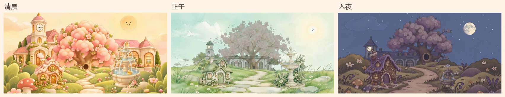

# 愈见花园 · Yujian Garden

这是一个比赛项目，你或许在这里可以学到一些 vibe coding 技巧。

愈见花园是一座可以用鼠标探索的二维绘本花园。在大厅选清晨、正午或入夜，进入插画后可以敲开小屋的门、从树洞抽出信笺、翻看回廊的画，或到喷泉旁跟着舞伴做动作。

## 项目里有什么

| 玩法 | 可以体验或学习什么 |
| --- | --- |
| 风格大厅与游园 | 日月沿弧线移动，草地响应鼠标，入园转场接到所选时段。分层插画、点击热区和局部动画共用画稿坐标。 |
| 树洞日记 | 保存和回看日记，了解 Flask 路由、账号会话和数据库读写如何接到一个画内入口。 |
| 樱桃小屋 | 三位主人分别迎客，聊天、语音和互动剧本按需接入服务。 |
| 心灵喷泉 | 观看实时水纹，进入舞厅后用摄像头驱动舞伴。姿态识别与节奏判定在浏览器里完成。 |
| 艺术回廊 | 查看图片、立体作品和音乐，或用自己的图片尝试不同的创作方式。 |

## 在自己的电脑上运行

项目使用 Python、Flask、MySQL 和 MongoDB。首次部署按[安装与启动](文档/02_安装部署.md)配置 Python 环境和空数据库，之后在 Windows 上双击 **一键启动.bat**，打开 `http://127.0.0.1:5000` 并注册自己的账号。游园和浏览器姿态识别可在本地体验。云端对话、语音和生成各自使用配置的服务。音乐目录支持自行放入已获授权的配乐。

## 从哪里读代码

- 想让一张画可以探索，从[花园模板](MindGarden/templates/creation/garden.html)和[景点切换](MindGarden/static/js/illustrated_garden.js)开始。跟着小屋的门环走一遍，可以看到一次点击怎样从全景进入近景，再把人带到聊天页面。
- 想让插画动起来，看[时钟、眨眼与水纹](MindGarden/static/js/garden_life.js)和[大厅草地](MindGarden/static/js/lobby_meadow.js)。[原画分层说明](文档/素材来源/二维花园.md)列出了替换一套画面所需的图层与尺寸。
- 想了解体感玩法，先看[人体关键点与舞伴驱动](MindGarden/static/js/garden_pose.js)，再看[如何按节拍判定动作](MindGarden/static/js/dance_game.js)。
- [第一次游园](文档/01_快速上手.md) · [项目结构](文档/04_项目结构.md) · [常见问题](文档/03_常见问题.md) · [交互与美术验收](文档/05_改版验收.md)

## 许可与素材

团队自有程序源码采用 [MIT 许可证](LICENSE)。随包第三方软件、浏览器模型和字体按各自许可使用，见[第三方说明](MindGarden/static/vendor/THIRD_PARTY_NOTICES.md)。项目画稿、角色图、截图与标识单独管理，MIT 对源码的授权不包含这些素材。对外分发或另作商用前请查阅[画稿来源](文档/素材来源/二维花园.md)并取得相应授权，也可以替换为自己的素材。
